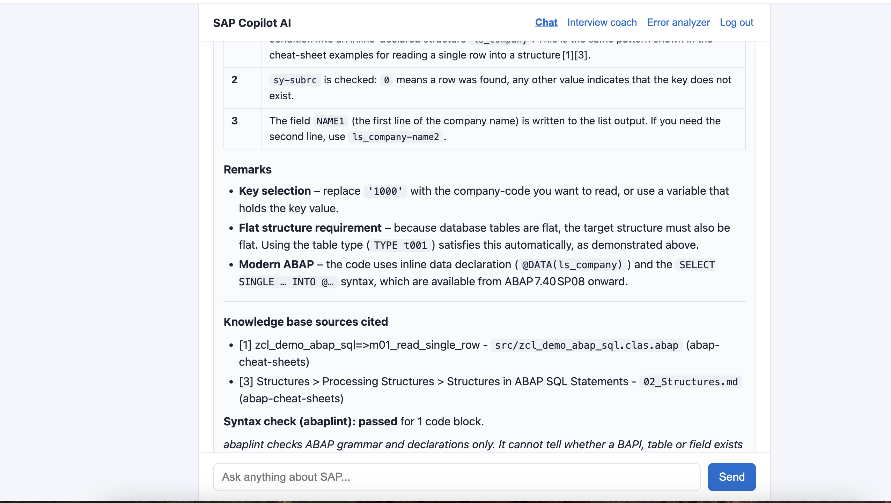
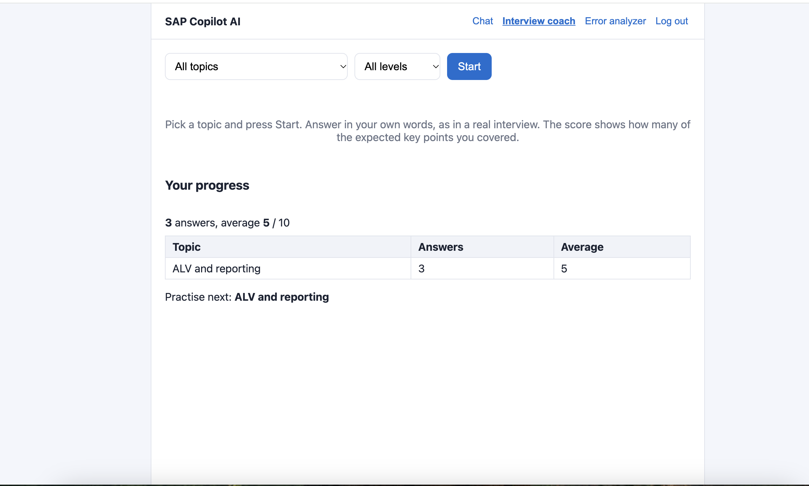
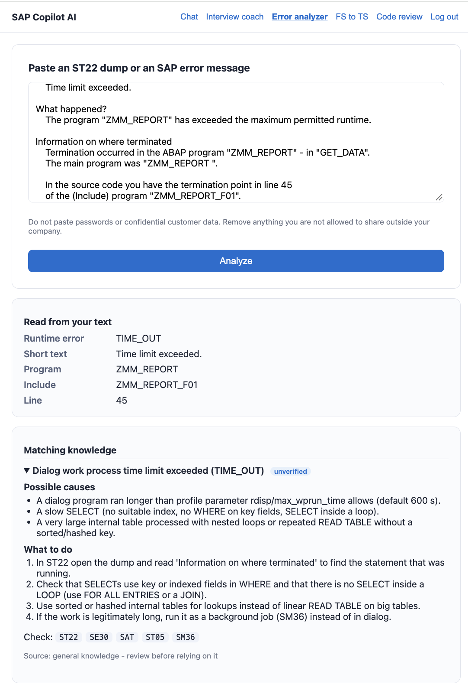
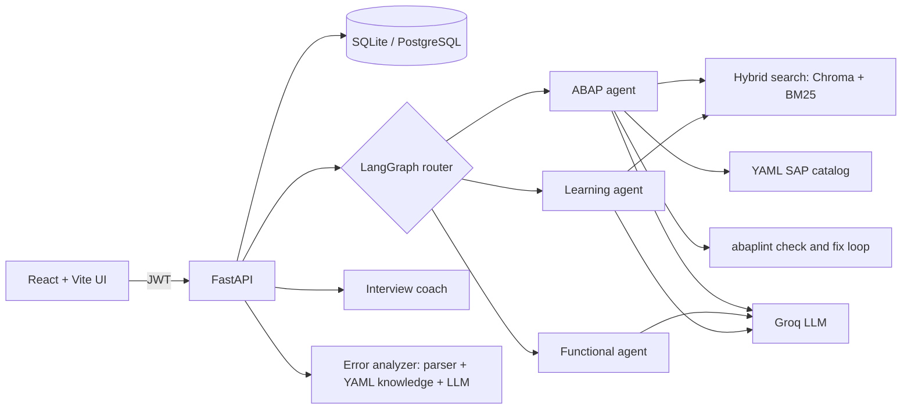

# SAP Copilot AI

An AI assistant for SAP developers, in the spirit of GitHub Copilot: it writes and explains ABAP, answers functional
questions, coaches for interviews and analyzes ST22 dumps and SAP error messages.
It is a personal portfolio project built by an SAP ABAP developer. It does **not** connect to any SAP system.

> **Honest status.** The code is tested (see Tests). The SAP knowledge shipped in `knowledge_base/` (catalog, interview
> questions, error entries) was written from general SAP knowledge and is marked `unverified`. Review it before
> relying on it, and never treat an AI answer as a replacement for checking your own system.

## Screenshots

| Chat with syntax and catalog checks | Interview coach | Error analyzer |
|---|---|---|
|  |  |  |

## What it does

| Feature | What you get | How it stays honest |
|---|---|---|
| **Chat with agents** | A router sends each question to an ABAP, Functional or Learning agent (LangGraph + Groq LLM). | Without an LLM key the router falls back to keyword rules. |
| **Knowledge base search (RAG)** | ABAP-aware chunking, vector search (Chroma + `bge-small-en-v1.5`), BM25 and hybrid ranking. Answers cite the excerpts they used. | Retrieval quality is measured with `evals/retrieval_cases.json`; the answer lists only sources it really cited. |
| **Syntax check with abaplint** | Generated ABAP is checked for grammar and declaration errors and the LLM gets one or two chances to fix them. | The note says "no grammar or declaration errors found" and that this is **not** a correctness check. abaplint cannot know whether a BAPI or field exists. |
| **SAP catalog check** | Function modules/BAPIs, structures and tables from YAML are given to the LLM before it answers and compared with the generated code afterwards. | Each entry has a status (`verified`, `documented`, `unverified`). Shipped entries are `unverified`. |
| **Interview coach** | 34 ABAP / CDS / RAP questions by topic and level, scored by the share of expected key points covered, with feedback and progress per topic. | The score is explicitly "key points covered", not a grade of overall quality. |
| **Error analyzer** | Paste an ST22 dump or an error message: parsed facts, matching known errors (causes, fix steps, tcodes) and an AI explanation. | Parsing only reports what is literally in the text. The AI is told to say what extra information it needs instead of guessing. |
| **FS to TS** | Paste a functional spec: which topics it mentions and which it does not (with the question to ask), SAP objects found, and an AI draft of the technical spec. | The topic check is a fixed keyword checklist. The draft must list what the FS does not say under "Open questions" instead of inventing tables or fields. |

## Architecture



## Tech stack

Python 3.12, FastAPI, SQLAlchemy, JWT + bcrypt, LangGraph, langchain-groq (llama-3.3-70b-versatile), fastembed, ChromaDB,
rank-bm25, abaplint (Node), pydantic, YAML knowledge files, React 18, Vite, react-markdown, pytest, GitHub Actions.

## Run locally

You need Python 3.11+ and Node 18+. A free [Groq](https://console.groq.com) API key is optional; without it the app runs,
but answers are placeholders and the AI explanation parts are switched off.

### 1. Backend
```bash
cd backend
python3 -m venv .venv
source .venv/bin/activate          # Windows: .venv\Scripts\activate
pip install -r requirements.txt
cp ../.env.example .env            # then edit backend/.env: set JWT_SECRET and, optionally, GROQ_API_KEY
uvicorn app.main:app --reload --port 8001
```
Start the server from inside `backend/` (it reads `backend/.env`). API docs: http://localhost:8001/docs

Generate a JWT secret with `python -c "import secrets; print(secrets.token_hex(32))"`.

### 2. Frontend
```bash
cd frontend
cp .env.example .env               # VITE_API_URL=http://localhost:8001
npm install
npm run dev
```
Open http://localhost:5173 (the backend allows exactly this origin; change `FRONTEND_ORIGIN` if you use another port).

### 3. Optional: syntax check and knowledge base
```bash
cd backend/tools/abaplint && npm install          # one-time, enables the abaplint check
cd ../.. && bash ../scripts/fetch_sources.sh      # downloads public sample repos into knowledge_base/raw (git-ignored)
python -m app.rag.cli ingest ../knowledge_base/raw/abap-cheat-sheets --source abap-cheat-sheets
python -m app.rag.cli search "read a single row from an internal table" -k 5
python -m app.rag.cli eval ../evals/retrieval_cases.json
```
The first ingest downloads the embedding model (~130 MB). Add your own Markdown notes under `knowledge_base/notes/`.

### 4. Docker (Postgres + backend)
```bash
cp .env.example .env     # set JWT_SECRET and optionally GROQ_API_KEY
docker compose up --build
```

## Tests

```bash
cd backend && source .venv/bin/activate
python -m pytest -q
```
About 130 tests cover the API, auth, chunker, retrieval, abaplint integration, catalog, interview coach, error analyzer and FS to TS.
They run offline (a hash embedder replaces the model download, the LLM is stubbed). GitHub Actions runs the backend tests and the
frontend build on every push.

## Configuration

| Variable | Purpose |
|---|---|
| `DATABASE_URL` | SQLite locally, PostgreSQL for Docker / hosting |
| `JWT_SECRET` | Long random string. Never commit it |
| `GROQ_API_KEY` / `GROQ_MODEL` | LLM access (optional) |
| `FRONTEND_ORIGIN` | Allowed CORS origin, default `http://localhost:5173` |
| `RAG_ENABLED`, `EMBEDDING_BACKEND`, `KB_DIR` | Knowledge base search |
| `ABAPLINT_ENABLED`, `ABAPLINT_MAX_FIXES` | Syntax check loop |
| `CATALOG_ENABLED`, `CATALOG_DIR`, `INTERVIEW_DIR`, `ERRORS_DIR` | Locations of the YAML knowledge files |

## API

| Method | Path | Description |
|---|---|---|
| GET | `/health` | health check |
| POST | `/auth/register`, `/auth/login` | create account, get JWT (form fields `username` = email, `password`) |
| GET | `/auth/me` | current user |
| POST | `/chat` | `{"message": "..."}` returns `{"agent", "answer"}` |
| GET | `/chat/history` | recent messages |
| GET | `/kb/search` | hybrid search (`q`, `k`, `mode`, filters) |
| GET | `/catalog/stats`, `/catalog/search`, `/catalog/{name}` | SAP catalog lookup |
| GET/POST | `/interview/topics`, `/question`, `/answer`, `/progress` | interview coach |
| POST | `/errors/analyze` | `{"text": "..."}` returns parsed facts, matches, explanation |
| GET | `/errors/coverage` | which runtime errors the knowledge base knows |
| POST | `/spec/generate` | `{"fs_text": "..."}` returns topic check, detected objects and a TS draft |

All endpoints except `/health` and `/auth/*` need `Authorization: Bearer <token>`.

## Project structure

```
backend/app/         main.py, config.py, models.py, security.py, routers/
  agents/            LangGraph router and agents, LLM wrapper, code and catalog checks
  rag/               chunker, embedder, store, retriever, ingest, CLI
  catalog/ interview/ errors/    YAML-backed knowledge modules (loader, validation, service)
  quality/           abaplint integration
backend/tests/       pytest suite
backend/tools/abaplint/          Node package that provides the abaplint CLI
frontend/src/        App.jsx, InterviewCoach.jsx, ErrorAnalyzer.jsx, Markdown.jsx, api.js
knowledge_base/      notes/, catalog/, interview/, errors/ (YAML). raw/ and chroma/ are git-ignored
evals/               retrieval test cases
.github/workflows/   CI
```

## Knowledge files: how to add your own

Each YAML folder has its own README with the format and a validator. Entries carry a `status` and a `source`.
Write entries in your own words from what you have verified; do not paste client or employer material into this repository.

## Known limitations

- No connection to a real SAP system. Nothing here is verified against one.
- abaplint checks syntax, not whether objects exist. LLM-generated BAPI parameter or field names can still be invented, even after the catalog check (the catalog covers only a small set of objects).
- The AI can be wrong. Notes below answers say what was and was not checked.
- Interview scores measure keyword/key-point coverage plus an AI check of the missed points. They are not an expert's grade.
- Local SQLite and a single-user dev setup; no rate limiting, no password reset, no email verification.
- Sessions use `sessionStorage` JWTs and the UI has no mobile layout work.

## Roadmap

- Code review mode (performance, clean ABAP, S/4HANA readiness)
- Verified catalog entries and sources, more interview and error entries written from real experience
- Deployment (Docker image with frontend, hosted database)
